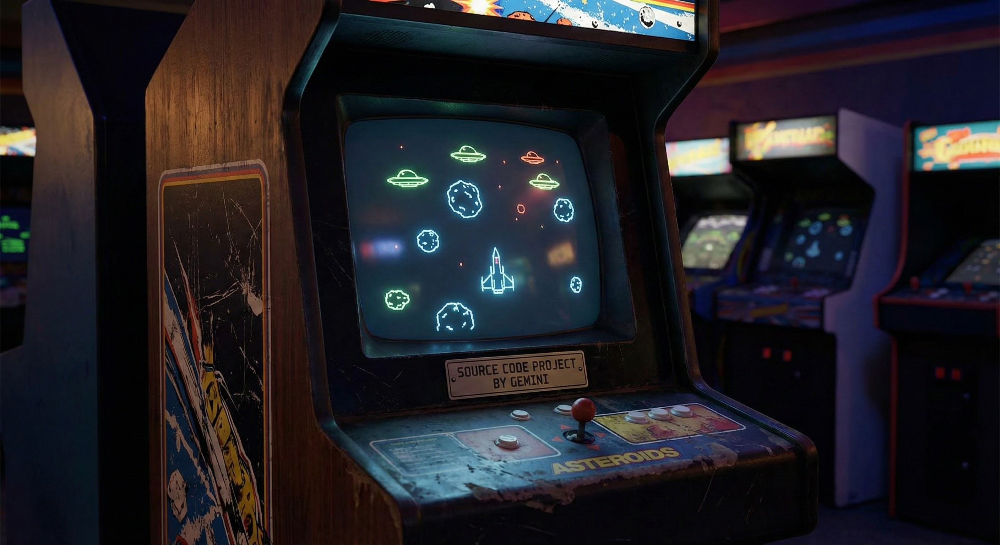

# Asteroids

[](https://github.com/scottdensmore/asteroids/actions/workflows/ci.yml)
[](https://github.com/scottdensmore/asteroids/releases/latest)
[](https://go.dev/)
[](LICENSE)
[](https://ebitengine.org/)

A vector-style recreation of the 1979 arcade classic, built in Go with
[Ebitengine](https://ebitengine.org/). Drift through a wrapping playfield,
split asteroids, dodge increasingly accurate saucers, and chase a high score
against a procedurally generated retro soundtrack.



## Features

- Momentum-based ship movement with screen wrapping
- Large, medium, and small asteroids with progressive splitting
- Big and small flying saucers with distinct movement, firing, and scoring
- Score-based difficulty, level progression, extra ships, and respawning
- Monochrome vector-style rendering with particles and invincibility effects
- Procedurally generated stereo audio with no external sound assets
- Version, commit, and build metadata embedded in release binaries
- Cross-platform release packages for Linux, macOS, and Windows

## Controls

| Key | Action |
| --- | --- |
| <kbd>Enter</kbd> | Start or restart the game |
| <kbd>Left Arrow</kbd> / <kbd>Right Arrow</kbd> | Rotate the ship |
| <kbd>Up Arrow</kbd> | Apply thrust |
| <kbd>Space</kbd> | Fire |

## Play

Download ready-to-run archives from the
[latest GitHub release](https://github.com/scottdensmore/asteroids/releases/latest).
Each release contains a platform-specific binary:

- Linux: `asteroids-linux-amd64-<version>.tar.gz`
- macOS: `asteroids-macos-<version>.tar.gz`
- Windows: `asteroids-windows-amd64-<version>.zip`

You can also run the game from source with
[Go 1.24.10 or newer](https://go.dev/doc/install):

```bash
git clone https://github.com/scottdensmore/asteroids.git
cd asteroids
go run ./cmd/asteroids
```

Ebitengine opens the game in an 800 x 600 desktop window. Linux source builds
need the system packages listed in the [contributing guide](CONTRIBUTING.md).

## Project documentation

- [Contributing and development](CONTRIBUTING.md)
- [Acknowledgments](ACKNOWLEDGMENTS.md)
- [MIT License](LICENSE)

## Manual releases

The release workflow runs only from **Actions → Manual release → Run workflow**.
Select the default branch and provide a new `vMAJOR.MINOR.PATCH` semantic version
and the full 40-character commit SHA selected for that dispatch. The SHA must
match the immutable default-branch commit used by the workflow. Historical
commits, existing tags, and existing releases (including drafts) are rejected.

The workflow validates inputs, runs formatting, vet, builds and uncached tests,
and packages the existing Linux, Windows and macOS binaries. It requires
compatible Go and system dependencies already present on the hosted runners;
it stops if they are missing. It downloads project Go modules but does not
install a toolchain or system packages. Automatic build/test CI remains separate.

Only after every platform succeeds does the publishing job create a lightweight
tag pointing to the tested SHA. It creates a draft GitHub Release, verifies the
uploaded archives and checksums against that SHA, and then publishes the release.
The existing three archive formats are retained, with `SHA256SUMS` and
`release-provenance.json` added. A failure after tag creation may leave a tag or
draft for manual inspection; retries never replace tags, overwrite assets, or
resume an existing release automatically. Dispatching this workflow is an
explicit request to create the tag and publish the GitHub Release.
